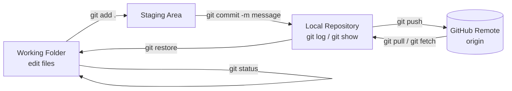
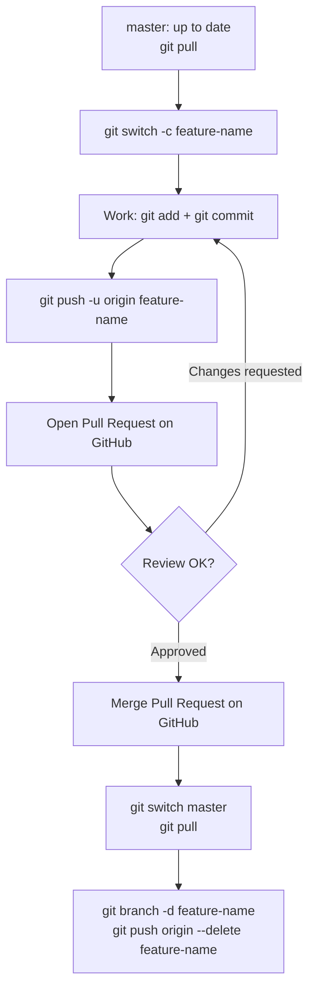

# Git and GitHub Commands – Beginner to Intermediate

## Introduction

This repository is a personal, self-written Git and GitHub learning reference. It documents every Git command I have learned so far, organized into clear folders by topic, with a dedicated Markdown file for each command. Each file explains the command's purpose, syntax, a practical example, step-by-step Windows Command Prompt instructions, expected output, a real-world use case, important warnings, and related commands.

The goal of this project is to build a solid, beginner-friendly foundation in Git and GitHub — from initializing a repository all the way through branching, merging, and collaborating with Pull Requests on GitHub.

## Learning Objectives

By working through this repository, the goals are to:

- Understand what Git is and how it tracks changes to files over time.
- Confidently use the core local Git workflow: `init → add → commit → log`.
- Create, switch between, and delete branches to isolate different pieces of work.
- Merge branches together and understand (and resolve) merge conflicts.
- Connect a local repository to GitHub and push, pull, and fetch changes.
- Understand the difference between `git fetch`, `git pull`, and `git push`.
- Understand the difference between `git add`, `git commit`, and `git push`.
- Use GitHub Pull Requests to review and merge changes safely.
- Know which commands are safe, and which (like `git restore`) can permanently discard work.

## Tools Required

| Tool | Purpose |
|---|---|
| [Git for Windows](https://git-scm.com/download/win) | Provides the `git` command used throughout this documentation. |
| Windows Command Prompt (`cmd`) | Used to run every command shown in this repository. |
| A [GitHub](https://github.com) account | Needed to host the remote repository and use Pull Requests. |
| A text editor (e.g. VS Code, Notepad) | For editing project files and resolving merge conflicts. |

## Installation and Setup

1. **Install Git for Windows** from [git-scm.com](https://git-scm.com/download/win), accepting the default options during setup.
2. **Verify the installation** by opening Command Prompt and running:
   ```text
   git --version
   ```
3. **Set your identity** (used to label your commits) — replace the name and email with your own:
   ```text
   git config --global user.name "Natesa Krishnan V"
   git config --global user.email "you@example.com"
   ```
4. **Create a practice folder** to follow along with the examples in this repository:
   ```text
   mkdir K:\GitPractice
   cd K:\GitPractice
   ```
5. **Create a free GitHub account** at [github.com](https://github.com) if you do not already have one, so you can follow the GitHub Remote Commands and GitHub Workflow sections.

## Complete List of Documented Commands

### 01 – Basic Git Commands
| Command | Description |
|---|---|
| [`git init`](01-Basic-Git-Commands/git-init.md) | Create a new, empty Git repository. |
| [`git status`](01-Basic-Git-Commands/git-status.md) | Show the current state of tracked/untracked/staged files. |
| [`git add filename` / `git add .`](01-Basic-Git-Commands/git-add.md) | Stage one file, or all changed files, for the next commit. |
| [`git commit -m "message"`](01-Basic-Git-Commands/git-commit.md) | Save staged changes permanently into history. |
| [`git log` / `git log --oneline`](01-Basic-Git-Commands/git-log.md) | View the full or compact commit history. |
| [`git show`](01-Basic-Git-Commands/git-show.md) | View the full details of a single commit. |

### 02 – Branch Commands
| Command | Description |
|---|---|
| [`git branch` / `-a` / `-r` / `branch_name`](02-Branch-Commands/git-branch.md) | List local/remote/all branches, or create a new one. |
| [`git switch branch_name` / `git switch -c branch_name`](02-Branch-Commands/git-switch.md) | Switch to an existing branch, or create and switch in one step. |
| [`git branch -d branch_name`](02-Branch-Commands/git-branch-delete.md) | Safely delete a local branch. |

### 03 – Merge Commands
| Command | Description |
|---|---|
| [`git merge branch_name` / `git merge --abort`](03-Merge-Commands/git-merge.md) | Combine another branch's history into the current branch; cancel a conflicted merge. |

### 04 – GitHub Remote Commands
| Command | Description |
|---|---|
| [`git remote -v` / `git remote add origin URL`](04-GitHub-Remote-Commands/git-remote.md) | View or create the connection between your local repository and GitHub. |
| [`git push origin master` / `-u` / `--delete`](04-GitHub-Remote-Commands/git-push.md) | Upload local commits to GitHub, or delete a remote branch. |
| [`git pull`](04-GitHub-Remote-Commands/git-pull.md) | Download and merge the latest changes from GitHub. |
| [`git fetch`](04-GitHub-Remote-Commands/git-fetch.md) | Download the latest changes from GitHub without merging. |

### 05 – Restore Commands
| Command | Description |
|---|---|
| [`git restore filename` / `git restore .` / `git restore --staged filename`](05-Restore-Commands/git-restore.md) | Discard working-folder changes, or unstage a file. ⚠️ Can be destructive. |

### 06 – GitHub Workflow
| Workflow | Description |
|---|---|
| [Pushing a project to GitHub](06-GitHub-Workflow/push-project-to-github.md) | Create a GitHub repository, connect it, and push a project for the first time. |
| [Creating and merging a Pull Request](06-GitHub-Workflow/github-pull-request.md) | Create a branch, push it, open a Pull Request, and merge it on GitHub. |
| [Branch collaboration workflow](06-GitHub-Workflow/branch-collaboration.md) | The full day-to-day cycle: sync, branch, work, push, review, merge, clean up. |

## Folder Navigation

```text
Git-Commands-Learning/
│
├── README.md                                 ← You are here
│
├── 01-Basic-Git-Commands/
│   ├── git-init.md
│   ├── git-status.md
│   ├── git-add.md
│   ├── git-commit.md
│   ├── git-log.md
│   └── git-show.md
│
├── 02-Branch-Commands/
│   ├── git-branch.md
│   ├── git-switch.md
│   └── git-branch-delete.md
│
├── 03-Merge-Commands/
│   └── git-merge.md
│
├── 04-GitHub-Remote-Commands/
│   ├── git-remote.md
│   ├── git-push.md
│   ├── git-pull.md
│   └── git-fetch.md
│
├── 05-Restore-Commands/
│   └── git-restore.md
│
└── 06-GitHub-Workflow/
    ├── github-pull-request.md
    ├── push-project-to-github.md
    └── branch-collaboration.md
```

## Basic Git Workflow Diagram

This diagram shows the core local workflow every Git command in the **01-Basic-Git-Commands** folder fits into, plus how it connects to GitHub.



## Branch Collaboration Workflow Diagram

This diagram shows how branching, merging, and Pull Requests fit together, matching [`branch-collaboration.md`](06-GitHub-Workflow/branch-collaboration.md).



## Learning Progress Checklist

- [x] `git init`
- [x] `git status`
- [x] `git add filename` / `git add .`
- [x] `git commit -m "message"`
- [x] `git log` / `git log --oneline`
- [x] `git show`
- [x] `git branch` / `-a` / `-r` / `branch_name`
- [x] `git switch branch_name` / `git switch -c branch_name`
- [x] `git branch -d branch_name`
- [x] `git merge branch_name` / `git merge --abort`
- [x] `git remote -v` / `git remote add origin URL`
- [x] `git push origin master` / `-u` / `--delete`
- [x] `git pull`
- [x] `git fetch`
- [x] `git restore filename` / `git restore .` / `git restore --staged filename`
- [x] Creating a GitHub repository
- [x] Connecting a local repository to GitHub
- [x] Pushing project files to GitHub
- [x] Creating and pushing a new branch
- [x] Creating a Pull Request
- [x] Merging a Pull Request
- [x] Deleting local and remote branches

## Author

**Natesa Krishnan V**
